  <div align="center">

  
  <br/>

  

  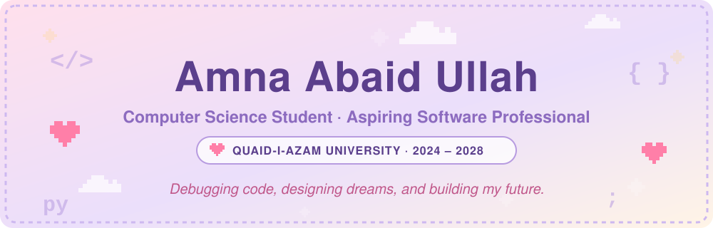

<a href="https://github.com/AmnaAbaidUllah-cmd/AmnaAbaidUllah-cmd"></a>

  <br/>

<a href="https://www.linkedin.com/in/amna-abaid-ullah/"></a>
&nbsp;
<a href="https://github.com/AmnaAbaidUllah-cmd"></a>
&nbsp;
<a href="mailto:amnaabaidullah58@gmail.com"></a>
&nbsp;
<a href="https://www.instagram.com/afsama_111"></a>

<br/><br/>

<a href="#about"><kbd> 🎀 About </kbd></a>
<a href="#toolbox"><kbd> 🧸 Toolbox </kbd></a>
<a href="#projects"><kbd> 💻 Projects </kbd></a>
<a href="#achievements"><kbd> 🏅 Achievements </kbd></a>
<a href="#stats"><kbd> 📊 Stats </kbd></a>
<a href="#contact"><kbd> 💌 Contact </kbd></a>

<br/><br/>

  
  
  

  

  </div>

<a id="about"></a>

## 🎀 A little about me...

  <table>
  <tr>
  <td width="72%" valign="top">

Hi, I'm **Amna** 👋 — a **Computer Science student at Quaid-i-Azam University (2024–2028)** and an aspiring software professional. I'm building strong foundations in **software development**, **AI**, and **modern computing systems**, and I love turning curiosity into code and ideas into impact.

Outside the terminal, I care deeply about **leadership**, **self-growth**, **photography**, and **creativity** — combining analytical precision with creative vision.

> _"A little pixel magic, a lot of ambition."_ 🐰

  </td>
  <td width="28%" align="center" valign="middle">

  

  </td>
  </tr>
  </table>

### 🌸 `amna.fetch` — System & Profile Info

```text
      (\_/)          amna@qau-cs
      ( •.•)         -----------
      / >🌸          OS: Linux / Ubuntu
                    Host: Quaid-i-Azam University (QAU), Islamabad
                    Degree: B.S. Computer Science (2024 – 2028)
                    Honor: 🥇 Gold Medalist & HSSC Topper (Sahiwal Board)
                    Languages: C++, Python, JavaScript, HTML5, CSS3
                    Focus: Software Engineering · AI Agents · Data Science
                    Tools: Git, GitHub, VS Code, Cursor, Claude, Slack, Jira
                    Creative: Photography, Lightroom, Premiere Pro, Photoshop
                    Status: Active Learner & Aspiring Software Professional ✨
```

  <div align="center"></div>

<a id="toolbox"></a>

## 🧸 My cozy toolbox

<sub>Technologies, frameworks and tools I work and experiment with: 🧰</sub>

  <h3 align="center">💻 Programming & Web</h3>

  <p align="center">
    <a href="https://isocpp.org"></a> &nbsp;
    <a href="https://www.python.org"></a> &nbsp;
    <a href="https://developer.mozilla.org/docs/Web/JavaScript"></a> &nbsp;
    <a href="https://developer.mozilla.org/docs/Web/HTML"></a> &nbsp;
    <a href="https://developer.mozilla.org/docs/Web/CSS"></a>
  </p>

  <h3 align="center">☁️ Cloud & Infrastructure</h3>

  <p align="center">
    <a href="https://aws.amazon.com"></a> &nbsp;
    <a href="https://cloud.google.com"></a> &nbsp;
    <a href="https://azure.microsoft.com"></a> &nbsp;
    <a href="https://www.kernel.org"></a> &nbsp;
    <a href="https://ubuntu.com"></a>
  </p>


  <h3 align="center">🧠 Data & AI</h3>

  <p align="center">
    <a href="https://pandas.pydata.org"></a> &nbsp;
    <a href="https://numpy.org"></a> &nbsp;
    <a href="https://www.mysql.com"></a> &nbsp;
  </p>

  <h3 align="center">🛠️ Tools & Workflow</h3>

  <p align="center">
    <a href="https://git-scm.com"></a> &nbsp;
    <a href="https://github.com"></a> &nbsp;
    <a href="https://code.visualstudio.com"></a> &nbsp;
    <a href="https://www.notion.so"></a> &nbsp;
    <br/>
    <a href="https://www.jetbrains.com/pycharm"></a> &nbsp;
    <a href="https://claude.ai"></a> &nbsp;
    <a href="https://www.anaconda.com"></a> &nbsp;
    <a href="https://www.kaggle.com"></a> &nbsp;
    <a href="https://colab.research.google.com"></a>
  </p>

  <h3 align="center">🎨 Creative Studio</h3>

  <p align="center">
    <a href="https://www.adobe.com/products/photoshop.html"></a> &nbsp;
    <a href="https://www.adobe.com/products/premiere.html"></a> &nbsp;
    <a href="https://www.capcut.com"></a>
    <br/>
    <a href="https://filmora.wondershare.com"></a> &nbsp;
    <a href="https://www.adobe.com/products/photoshop-lightroom.html"></a> &nbsp;
    <a href="https://www.canva.com"></a> &nbsp;
    <a href="https://www.audacityteam.org"></a> &nbsp;
  </p>

  <div align="center"></div>

<a id="projects"></a>

## 💻 Featured Projects

  <div align="center">

> 🌱 _"Turning curiosity into code — exploring core CS fundamentals, algorithms, software development, and AI agent architectures."_ 🚀

  <!--
    HOW TO ADD PINNED REPOSITORY CARDS:
    <table>
    <tr>
    <td width="50%"><a href="https://github.com/AmnaAbaidUllah-cmd/YOUR_REPO_1"></a></td>
    <td width="50%"><a href="https://github.com/AmnaAbaidUllah-cmd/YOUR_REPO_2"></a></td>
    </tr>
    </table>
  -->

  </div>

  <div align="center"></div>

<a id="achievements"></a>

## 🏅 Achievements & Recognition

  <div align="center">

  

<br/><br/>

  <table width="92%">
  <tr>
  <td width="33%" align="center" valign="top">
    
    <br/><br/>
    <b>🥇 HSSC Board Topper</b>
    <br/>
    <sub>Sahiwal Board · Higher Secondary Certificate</sub>
  </td>
  <td width="33%" align="center" valign="top">
    
    <br/><br/>
    <b>🎓 Quaid-i-Azam University</b>
    <br/>
    <sub>Admitted on Merit · CS Department</sub>
  </td>
  <td width="33%" align="center" valign="top">
    
    <br/><br/>
    <b>⚡ Developer Spirit</b>
    <br/>
    <sub>Gold-medal standard in every line of code</sub>
  </td>
  </tr>
  </table>

  </div>

  <div align="center"></div>

<a id="stats"></a>

## 📊 GitHub Stats

  <div align="center">

  
  &nbsp;
  

<br/><br/>

  

<br/><br/>

  

  </div>

<a id="contact"></a>

## 💌 Let's connect

Always happy to connect about **software development, AI, photography, or creative ideas** — say hi! 🐰

  <div align="center">

<a href="https://www.linkedin.com/in/amna-abaid-ullah/"></a>
&nbsp;
<a href="https://github.com/AmnaAbaidUllah-cmd"></a>
&nbsp;
<a href="mailto:amnaabaidullah58@gmail.com"></a>
&nbsp;
<a href="https://www.instagram.com/afsama_111"></a>

<br/><br/>

  

<sub>🐰 Made with a little pixel magic and a lot of ambition 🌸</sub>

  </div>
